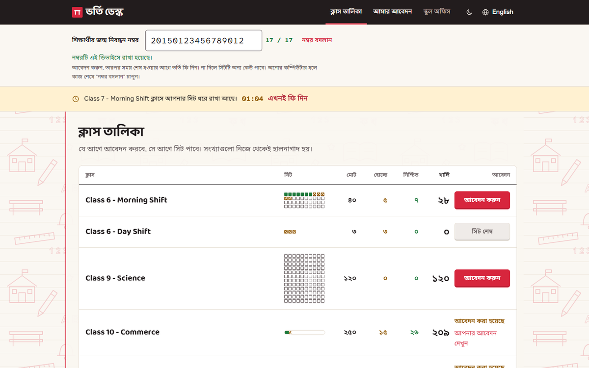
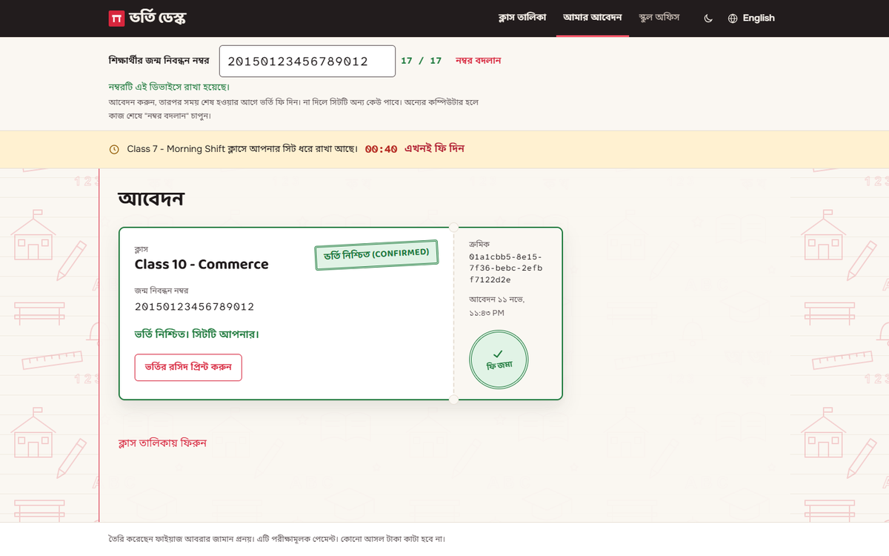
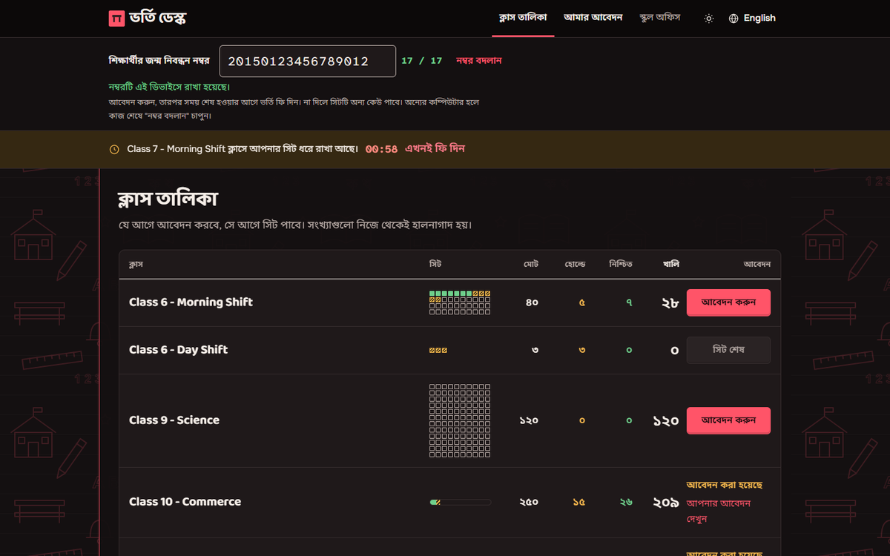
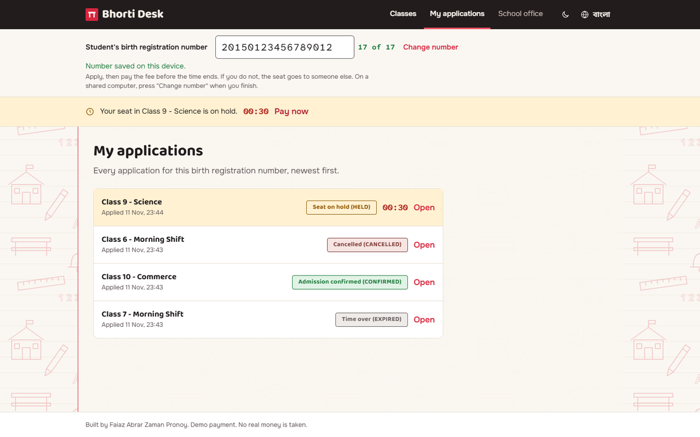
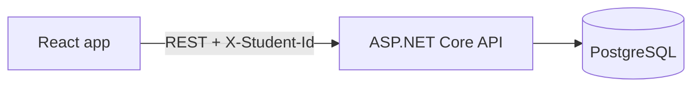

# Bhorti Desk (ভর্তি ডেস্ক)

**An online school admission system. Parents apply for a seat, the seat is held for 10 minutes, and they pay the fee to confirm it.**
First come, first served. If the fee is not paid in time, the seat goes back to the class for the next person.

| | |
|---|---|
| **Type** | Take-home assignment, solo (not for a course) |
| **Made by** | Faiaz Abrar Zaman Pronoy |
| **History** | Built in November 2026 |
| **Docs** | [Assumptions](ASSUMPTIONS.md), [AI usage](AI_USAGE.md) |

| | |
|---|---|
|  |  |
|  |  |

---

## Features

**For the school office**
- Create a class with a name and a number of seats
- Each shift is its own class, for example "Class 6 - Morning Shift"
- A live table of every class: total, on hold, confirmed and free seats
- The form checks every field before it sends anything

**For parents**
- Type the student's 17 digit birth registration number once, at the top of the page
- Bangla digits, spaces and hyphens are fine. The box counts the digits for you
- See every class with live seat numbers. They update every few seconds
- Apply with one tap. The seat is held for you
- A large countdown shows the time left. The last minute turns red
- Pay the fee to confirm the seat. The payment is a demo. No real money moves
- Cancel if you change your mind. The seat goes back to the class
- When the time runs out, the page shows EXPIRED at once. No reload needed
- "My applications" lists every application for this number
- Close the browser and come back later. Your running application is still there

**The seat rules**
- A class never has more held and confirmed seats than its total, however many people apply at once
- One student can have only one active application in a class
- Only the owner can pay for or cancel an application
- Paying twice still counts one seat
- Expired seats free themselves. No background job is needed
- Data stays after a restart

**Everything else**
- Bangla and English, with Bangla first
- Light and dark mode
- Works on phone, tablet and desktop
- Every error has a plain message. No blank pages
- A banner shows when the server cannot be reached, and the app keeps trying

---

## Built with

| Part | Tools |
|---|---|
| API | C#, .NET 10, ASP.NET Core |
| Database | PostgreSQL 17, Npgsql, Dapper with plain SQL |
| Web app | React 19, TypeScript, Vite, Tailwind CSS 4, TanStack Query, React Router |
| Tests | xUnit against a real PostgreSQL, Vitest, Testing Library |
| Running it | Docker Compose, nginx |

---

## How it works



1. **Apply.** The API opens one transaction and locks the class row. Every other request for that class waits its turn.
2. **Count.** Inside the lock, it counts the seats in use: confirmed ones, and held ones whose time is not over.
3. **Hold.** If a seat is free, it saves the hold with an end time from the database clock.
4. **Pay.** Paying takes the same lock, so it can never race with a new applicant at the last second.
5. **Expire.** Nothing runs on a timer. A hold whose time has passed simply stops counting.

The lock lives in PostgreSQL, so this also holds when two copies of the API share one database.
More detail in [ASSUMPTIONS.md](ASSUMPTIONS.md).

---

## Tests

| Suite | Tests | What they check |
|---|---|---|
| Backend | 27 | 300 students at once for 10 seats and for 1 seat. 900 requests with repeat clicks on two backends. Paying in the exact second a hold ends. Expiry, owner checks, bad input, the API contract, restarts |
| Frontend | 19 | The countdown reaches EXPIRED without a reload. The number box. Both languages have the same words. Error messages. Server down |

After each stress test, the database is checked with plain SQL. No class may have more seats in use than it has.

---

## Run it

You only need Docker.

- **Windows:** double-click `RUN-BhortiDesk.bat`. It starts Docker if needed, builds and starts the containers, waits for the API and opens the app.
- **Any system:**

```bash
docker compose up
```

- App: http://localhost:3000
- API: http://localhost:8080 (try http://localhost:8080/classes)

The first run builds everything. It takes a few minutes.
A new database is empty. Open "স্কুল অফিস" (School office) and create a class first.

`docker compose down` stops the app and keeps the data.
`docker compose down -v` also deletes the data.

### Settings

It works without a `.env` file. To change a value, copy `.env.example` to `.env`.

| Variable | Default | What it does |
|---|---|---|
| `HOLD_DURATION_SECONDS` | `600` | How long a seat stays on hold |
| `API_BASE_URL` | `http://localhost:8080` | Where the web app finds the API |
| `CORS_ALLOWED_ORIGINS` | `*` | Which sites may call the API |
| `FRONTEND_PORT` | `3000` | Port for the web app |
| `POSTGRES_DB`, `POSTGRES_USER`, `POSTGRES_PASSWORD` | local values | Database login. For local use only |

### Run the tests

```bash
docker compose -f docker-compose.tests.yml run --rm backend-tests
```

```bash
docker compose -f docker-compose.tests.yml run --rm frontend-tests
```

```bash
docker compose -f docker-compose.tests.yml down
```

### Try the rules yourself

**Expiry.** Start with a 30 second hold. Apply, then watch the countdown reach zero.

```bash
HOLD_DURATION_SECONDS=30 docker compose up
```

On Windows PowerShell: `$env:HOLD_DURATION_SECONDS=30; docker compose up`

**Two backends.** A second API runs on port 8081 with the same database.

```bash
docker compose --profile two-backends up
```

**Restart.** Run `docker compose down`, then `docker compose up`. Your classes and applications are still there.

### If a port is busy

- Port 3000: set `FRONTEND_PORT=3001` and open http://localhost:3001.
- Port 8080: change the backend port in `docker-compose.yml` to `"8090:8080"` and set `API_BASE_URL=http://localhost:8090`.

---

## Project layout

```
backend/
  src/SchoolAdmission.Api/          controllers, services with plain SQL, database schema
  tests/SchoolAdmission.Api.Tests/  tests against a real PostgreSQL
frontend/
  src/features/                     classes, applications, school office, number box
  src/i18n/                         Bangla and English words
  nginx/                            web server settings
  tests/
docker-compose.yml                  database, API and web app
docker-compose.tests.yml            backend and frontend tests
```

---

## License

MIT. See [LICENSE](LICENSE).
