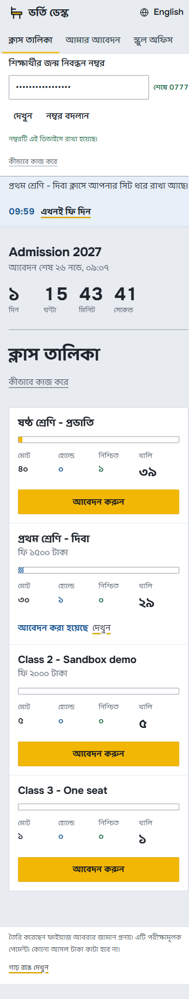
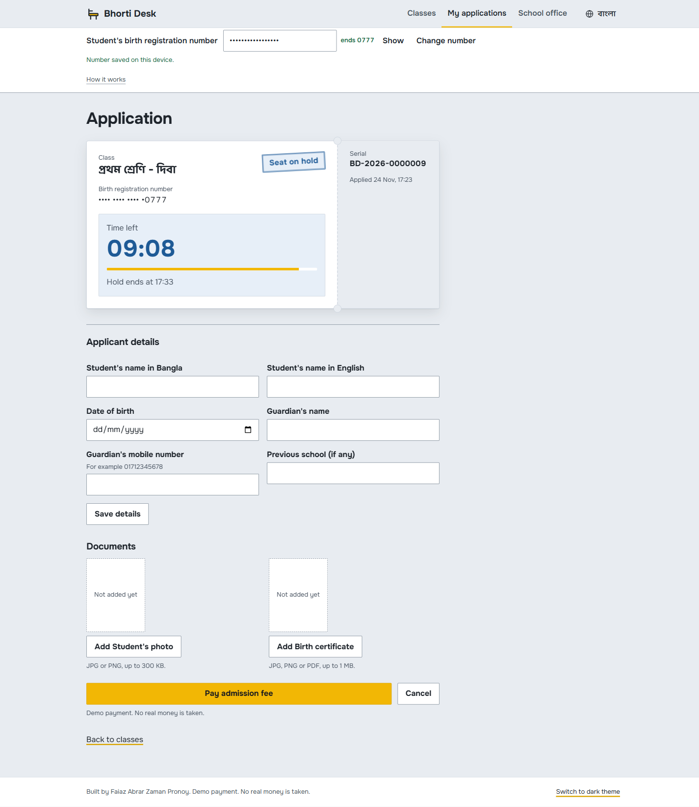
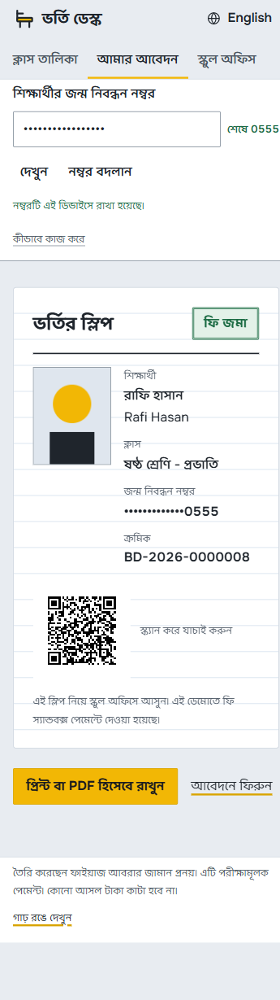
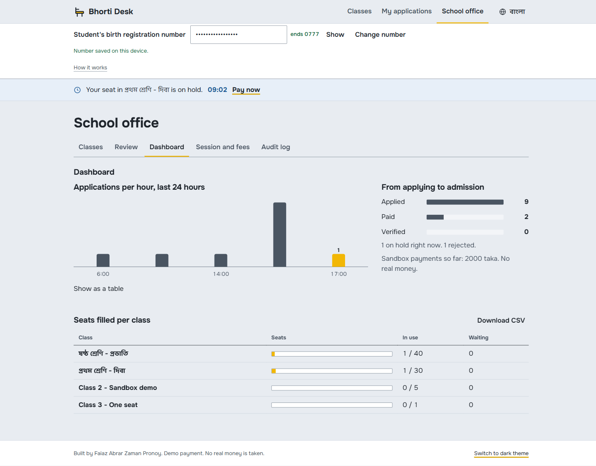
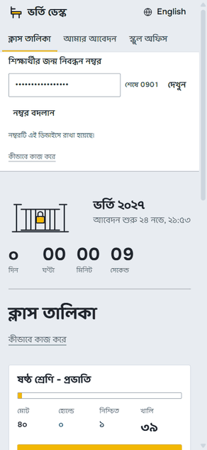

# Bhorti Desk (ভর্তি ডেস্ক)

**An online school admission desk. Guardians apply for a seat, the seat is held for ten minutes, and they pay to keep it. The school office runs the season: the window, the fees, the review and the reports.**

First come, first served, with a fair waiting list. However many people apply at once, a class never has more seats in use than it has.

| | |
|---|---|
| **Type** | Portfolio project, built from a take-home assignment |
| **Made by** | Faiaz Abrar Zaman Pronoy |
| **Docs** | [Assumptions](ASSUMPTIONS.md), [Architecture](docs/architecture.md), [Security review](docs/security.md) |

| | |
|---|---|
|  |  |
|  |  |

**Walkthrough** (36 seconds, recorded with Playwright on the real app): the session opens, a guardian applies, fills the form, adds a photo, pays in the sandbox, the stamp lands, the slip with its QR, and the public check.



---

## What it does

**For guardians**
- See whether admission is open, with a countdown on the server's clock
- Apply with one tap; the seat is held for ten minutes with a live countdown
- Fill in the student's details and upload a photo and the birth certificate
- Pay the fee through a sandbox gateway that follows a real flow. No real money moves, and every screen says so
- Join the waiting list of a full class; a freed seat is offered in order, with its own timer
- Print the admission slip, or save it as a PDF; its QR opens a public check page
- Notices for every step: on hold, two minutes left, paid, verified, rejected, time over, seat offered

**For the school office**
- Admission sessions with an opening and a closing time
- A fee and an age rule per class (minimum and maximum age on a cut-off date)
- Review paid applications: look at the documents, verify, or reject with a reason. A rejection frees the seat at once and marks the fee as due for refund
- Edit, close and reopen classes. Seats can go down, but never below the seats in use
- A dashboard: applications per hour, the funnel, seats filled per class, the waiting lists, sandbox revenue. CSV export
- An audit log of every office action, filterable and exportable

**Rules that always hold**
- Held plus confirmed seats never exceed a class's total, from one backend or two
- Seat counts are counted from the rows, never stored
- One active application per student per class
- A payment is taken once, however many times the button or the callback fires
- The birth registration number is masked to its last four digits everywhere
- The original eight endpoints answer exactly as the assignment says, with no login, on default settings

---

## Numbers

All measured on 24 and 25 November 2026 on one Windows laptop with Docker Desktop 29.9.2 (8 CPUs, about 3.8 GB for Docker). .NET SDK 10.0.404, Node 22.23.5, PostgreSQL 17.11, nginx 1.29.8, k6 2.4.0.

**Tests.** 99 backend tests against a real PostgreSQL, 47 frontend tests, all passing. The concurrency, stress, two-backend and waiting-list tests passed 20 runs in a row, each on a fresh database. The eight original contract test files are byte for byte the ones submitted for the assignment.

**Load test** (`loadtest/`). 600 guardians at once, each pressing Apply twice, for the last 10 seats of a class of 50, through nginx in front of two backends:

| | |
|---|---|
| Requests | 1242 |
| Seats taken in the rush | 10 of 10 |
| Server errors | 0 |
| Throughput | 137.7 requests per second |
| Median wait | 2.74 s |
| 95th percentile wait | 5.44 s |
| SQL check afterwards | 0 classes over their total, 0 students with two live seats |

Every request for one class waits its turn at the class's row lock, so a crowd for one class is served one at a time; that is the price of never overbooking. These numbers come from the laptop above, not from any free hosting plan.

**First load on a phone** (Playwright, 390 px wide, no cache): 4 requests, 178 KB (167 KB of JavaScript), up from 161 KB before the season features. Fonts are self-hosted and split by script. Lighthouse was not run.

---

## Built with

| Part | Tools |
|---|---|
| API | C#, .NET 10, ASP.NET Core, Dapper with plain SQL, QRCoder (MIT) |
| Database | PostgreSQL 17 |
| Web app | React 19, TypeScript, Vite, Tailwind CSS 4, TanStack Query, React Router |
| Tests | xUnit against a real PostgreSQL, Vitest, Testing Library, k6 |
| Running it | Docker Compose, nginx, GitHub Actions |

---

## Run it

You only need Docker.

```bash
docker compose up
```

- App: http://localhost:3000
- API: http://localhost:8080 (try http://localhost:8080/classes)
- API description: http://localhost:8080/openapi/v1.json

A new database is empty. Open "স্কুল অফিস" (School office) and create a class first. The office tabs other than Classes need the staff login below.

**Local demo logins** (change both in `.env` before anyone else can reach the app):
- School office: `admin@bhortidesk.local` / `change-this-local-password`
- Guardian sign-in (only with `SIGN_IN_REQUIRED=true`): any 01X mobile number; the code is printed by `docker compose logs backend`

`docker compose down` keeps the data. `docker compose down -v` deletes it.

### Settings

Every value has a default; copy `.env.example` to `.env` to change one.

| Variable | Default | What it does |
|---|---|---|
| `HOLD_DURATION_SECONDS` | `600` | How long a seat stays on hold |
| `SIGN_IN_REQUIRED` | `false` | `true`: guardians and staff must sign in. Off keeps the original no-login API |
| `RATE_LIMITS_ENABLED` | `false` | Limits on sign-in and applying. Turn on for real use |
| `HOLD_COOLDOWN_SECONDS` | `0` | Wait before re-applying after an unpaid hold ran out |
| `DEMO_MODE` | `false` | Public demo: a banner, the sign-in code on screen, a daily reset |
| `PAYMENT_SANDBOX_SECRET`, `SLIP_SECRET` | local value | Secrets for payment callbacks and slip codes. Set both |
| `SEASON_WORKER_SECONDS` | `5` | How often freed seats are offered to the waiting list |
| `PUBLIC_APP_URL` | the request's origin | Address the slip QR points to |

### Tests

```bash
docker compose -f docker-compose.tests.yml run --rm backend-tests
docker compose -f docker-compose.tests.yml run --rm frontend-tests
docker compose -f docker-compose.tests.yml down
```

### Load test

```bash
docker compose -p bhorti-load -f docker-compose.yml -f loadtest/docker-compose.loadtest.yml --profile two-backends up -d --build postgres backend backend-second loadbalancer
docker compose -p bhorti-load -f docker-compose.yml -f loadtest/docker-compose.loadtest.yml --profile two-backends run --rm k6
docker compose -p bhorti-load -f docker-compose.yml -f loadtest/docker-compose.loadtest.yml --profile two-backends exec -T postgres psql -U school_admission -d school_admission < loadtest/check-seats.sql
docker compose -p bhorti-load -f docker-compose.yml -f loadtest/docker-compose.loadtest.yml --profile two-backends down -v
```

### Health and metrics

- `GET /health`: the database answers
- `GET /ready`: the database answers and the schema is in place
- `GET /metrics`: holds created, seat conflicts, waiting-list offers, payment callbacks, since this process started
- Logs are one JSON object per line; every line written during a request carries its `X-Request-Id`

---

## Project layout

```
backend/
  src/SchoolAdmission.Api/          controllers, services with plain SQL, the schema
  tests/SchoolAdmission.Api.Tests/  tests against a real PostgreSQL
frontend/
  src/features/                     classes, applications, payments, slip, waiting list, school office
  src/i18n/                         Bangla and English words
  nginx/                            web server settings and security headers
loadtest/                           k6 rush on two backends, and the SQL check
docs/                               architecture, decisions, security review
```

---

## License

MIT. See [LICENSE](LICENSE).
