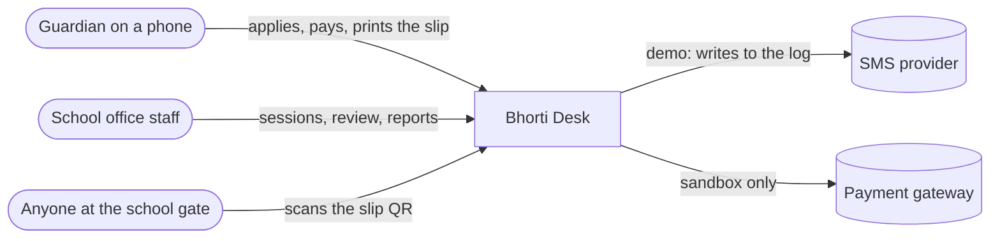
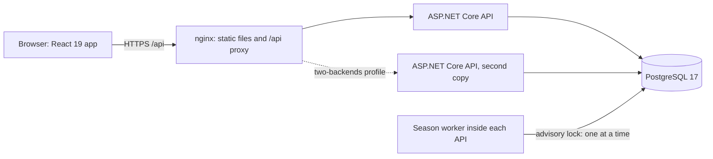
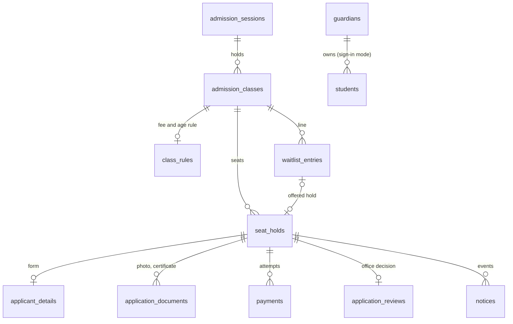
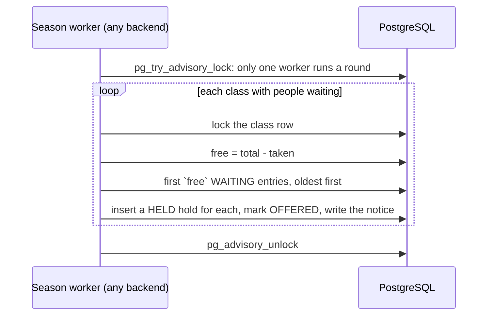

# Architecture

## Context



## Containers



Everything that matters lives in PostgreSQL. An API process keeps nothing in memory that another process needs, which is why two copies can share one database.

## Data



Seat counts are never stored. A class's taken seats are its CONFIRMED holds plus its HELD holds whose time has not passed, counted when asked.

## Apply

```mermaid
sequenceDiagram
  participant G as Guardian
  participant A as API
  participant D as PostgreSQL
  G->>A: POST /classes/{id}/holds (X-Student-Id)
  A->>D: quick look: full? (no lock, can only say "full")
  A->>D: begin; select ... for update on the class row
  A->>D: window open? expire old holds; offer freed seats to the line first
  A->>D: already holding? anyone still waiting? count taken seats
  A->>D: insert HELD with expiry from the database clock; commit
  A-->>G: 201 with expiresAt and serverTime
```

## Pay

```mermaid
sequenceDiagram
  participant G as Guardian
  participant A as API
  participant S as Sandbox gateway page
  participant D as PostgreSQL
  G->>A: POST /applications/{id}/payments + Idempotency-Key
  A->>D: insert payment PENDING (same key returns the same row)
  A-->>G: hostedPageUrl
  G->>S: Pay (sandbox)
  S->>A: POST /payments/callback, body + X-Signature (HMAC-SHA256)
  A->>A: check signature in constant time, check amount
  A->>D: lock class, lock payment; HELD and not expired? CONFIRMED : LATE
  A-->>G: stamp lands on the token
```

## Waiting list offer



If the worker is not running, the same offer step runs inside every apply and every "my waiting list" request, so nobody waits on a sleeping worker.

## Decisions

### ADR 1: lock the class row instead of retrying on conflicts
Every request for a class waits its turn at `select ... for update` on that class row. Optimistic retries would make hundreds of people collide on the last seat and retry again and again; SERIALIZABLE would fail many transactions in a rush. A row lock gives everyone one clear answer, and it only blocks requests for the same class.

### ADR 2: count seats instead of storing them
A stored counter needs something to decrease it when a hold expires, and if that job is late the seat stays lost. Counting CONFIRMED plus unexpired HELD rows at read time makes a seat free the instant its time passes, with nothing to keep in sync.

### ADR 3: an advisory lock for the background worker
With two backends, two workers would offer the same freed seat twice. `pg_try_advisory_lock` lets exactly one worker run a round; the other skips it. The offer itself still runs under the class row lock, so even two offers at once could not overfill a class.

### ADR 4: HMAC for slip codes and payment callbacks
A slip code is the hold id plus a truncated HMAC of it. Anyone can read it; nobody without the secret can make a new one, and a changed character fails the check. Payment callbacks carry an HMAC of the exact body, compared in constant time, so a forged "paid" message is refused.

### ADR 5: new features on new endpoints
The eight original endpoints are a frozen contract. Sign-in, rate limits and the cooldown are off by default, and every newer feature lives on its own path, so the original tests pass unchanged on default settings.
